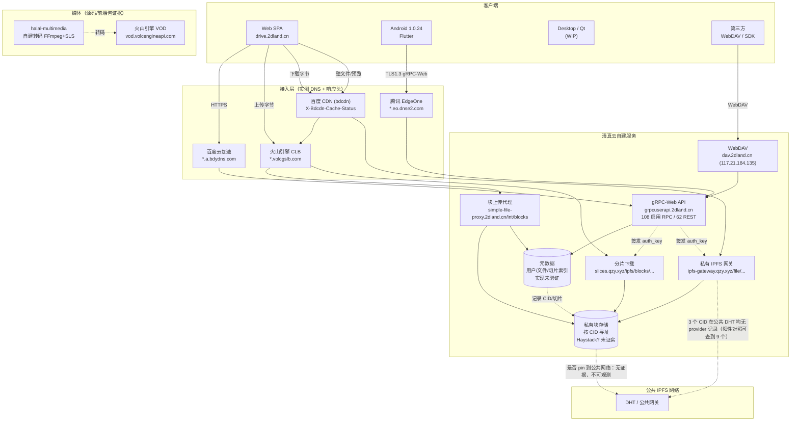
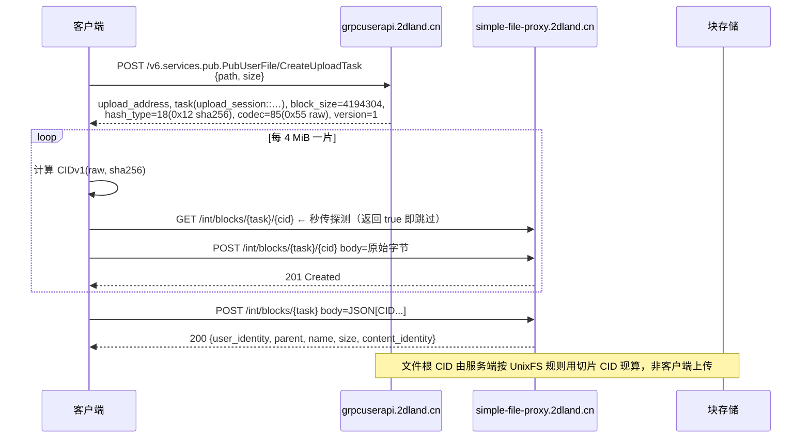

# 清真云（HalalCloud）运行方式与功能验证审查报告

> **报告用途**：为 MyDrive（`tuo8/wp`）评估清真云能否作为存储后端，并如实记录其当前架构、API、上传下载链路与存储机制。
> **审查日期**：2026-11-22 20:45 — 22:40（GMT+8，UTC+8）；证据整理与复核 2026-11-22 22:00 — 23:10
> **审查方式**：官方源码审查 + 官网/仓库资料 + **本人在授权账号内的真实上传/下载/CID 校验**
> **审查者**：WorkBuddy（自动化审计代理）；账号、令牌、密钥全部打码为 `[REDACTED]`
> **测试账号**：本人合法账号（`[REDACTED]`），额度 12 TiB，已用约 4.90 TiB
> **报告版本**：v1.1
> **原始证据**：同仓库 [`audit/`](audit/README.md)（脱敏后的脚本与结果，逐文件 SHA-256 见 `audit/MANIFEST.json`）

### 修订记录

| 版本 | 变更 |
|---|---|
| v1.0 | 首版：完成实测与结论 |
| v1.1 | ① 把 `audit/` 证据与脚本正式入库，逐项核对数量/文件名/大小/SHA-256；② 纠正"6 个测试文件"的计数（实为 11 次上传、6 种内容）；③ 区分「DHT provider 查询为空」与「公共网关不可访问」，并补做阳性对照，撤销原「公共网关取不到 = A」的判定；④ 新增 XOR 单字节处理的安全边界说明；⑤ 明确 240 秒窗口的证据边界（含同 CID 混淆项）；⑥ 重算「客户端直连 + Telegram 双写」的真实服务器流量；⑦ 列出无法找回的证据 |

---

## 0. 边界声明（本次实际遵守的约束）

| 约束 | 执行情况 |
|---|---|
| 只使用本人账号与自制测试文件 | ✅ 全部测试文件由 `audit/scripts/gen_files.py` 用固定种子生成，6 种内容、共 11 次上传（见 §7.1 明细） |
| 不删除/修改既有文件 | ✅ 只删除**本次自建**的 3 个对象（video / 1m / ttl 文本），删除前已留存哈希与签名 URL；其余 8 个 `hc-*` 对象仍在账号根目录，用户可自行清理 |
| 无付费、无压测、无并发、无枚举 | ✅ 全程串行，单文件最大 20 MiB，未发起任何批量/并发请求 |
| 不绕过鉴权/证书固定 | ✅ 未做任何 MITM 解密；上传下载全部走官方公开 API 与官方下发的签名 URL |
| 敏感信息打码 | ✅ Token / auth_key / session / 用户 ID / WebDAV 口令 / appsecret 均以 `[REDACTED]` 呈现；入库证据经二次扫描 0 命中 |

> 说明：本次是**协议层直连**（用官方 Web 客户端同一套签名算法调用官方 gRPC-Web 接口），不等同于"用第三方客户端替代官方 App"。所有文件操作都可在官方 Web 端看到同样结果。

---

## 1. 执行摘要

### 1.1 一句话结论

**清真云是一个"IPFS 内容寻址 + 自建块存储 + 商业 CDN 加速"的混合架构：文件确实按 IPFS UnixFS 规则切片并生成真实 CID（可离线复算验证），但数据只存在清真云自建的私有块存储里，由火山引擎 CLB 与百度 CDN 承载。**

**关于"是否接入公共 IPFS 网络"，本次只能给出有限结论**：3 个自有 CID 在公共 DHT 路由节点（delegated-ipfs.dev）上查不到任何 provider 记录，而同一接口查询公开已知 CID 可返回 9 个 provider（阳性对照），说明"查不到"是**针对这些 CID 的结果**而非接口失效；但 DHT 查询只代表单个路由节点的视角，**不足以证明"全球公共网络里绝对没有节点"**。公共网关能否取回内容，本次因本机网络限制**未取得有效样本**，不作结论（详见 §4.1、§11.3）。

### 1.2 服务当前状态

| 项 | 结论 | 证据等级 |
|---|---|---|
| 官网声明 | 已进入**封存阶段（Archive Mode）**："已停止主动开发与维护……服务可用性、数据完整性及功能稳定性不再作出保证" | **C**（官网 2dland.cn 原文） |
| 登录/API | 仍可用；OAuth refresh 正常换发令牌，抽查的 20+ 个关键 RPC 全部返回正常 | **A**（本次实测，非 113 个全量） |
| 上传 | 可用，实测 11 次上传全部成功（6 种内容） | **A** |
| 下载 | 可用，6 种内容全部取回且 SHA-256 一致 | **A** |
| WebDAV | 可用（PROPFIND 返回 207） | **A** |
| 分享 | API 可创建（返回 share identity，但原始响应未落盘） | **B**（创建）/ **未验证**（匿名下载页行为） |
| 视频转码 | 未实测（无合规自制视频、本机无 ffmpeg）；源码/前端包存在两套转码方案证据 | **B/D** |
| 新用户注册 | 页面存在但需腾讯防水墙验证码，未注册 | **未验证** |
| 客服/工单 | `PubTicket` 服务存在且可列取 | **A**（接口存在）/ 未提交工单 |
| 公共 IPFS 取回 | **无法验证**：DHT 无 provider 记录；6 个公共网关的失败全部发生在网络/中间层（429 限流、TLS 失败、Cloudflare 1010），阳性对照同样失败 | **未验证** |

### 1.3 结论可信度

- **架构判定（混合、自建存储 + CDN）**：高。两条独立证据链（CID 可离线复算、数据面域名与 CDN 头）互相印证。
- **"是否接入公共 IPFS 网络"**：中。DHT 查询为空且有阳性对照，但单节点视角不足以断言"全球不存在节点"；公共网关验证失败于网络层，未形成证据。
- **功能矩阵**：中高。API 与 Web 端功能已实测；Android 端逐项点击未全部执行（已标注）。
- **容量/长期保留承诺**：低。官方已声明"不再保证数据完整性"，且额度是**逻辑额度**（12 TiB），无任何 SLA 或保留期条款。

### 1.4 是否适合 MyDrive 集成

**可以接入，但不能作为唯一主存储。** 推荐"方案 E：可选外部来源 + 客户端直连取数 + 服务端双写"，理由与流量账见 §10。

### 1.5 三个最大风险

1. **服务已封存**：官方明确不保证可用性与数据完整性，随时可能停服且无赔偿条款。
2. **删除有可观测的延迟窗口**：实测删除后元数据立即失效，但**旧签名 URL 仍能取回完整明文**。受控计时中删除后 0/30/60/120/240 秒共 5 次采样全部 200 且哈希一致；**窗口在 240 秒观测结束时仍未关闭，但这不等于永久保留**（详见 §4.2 的证据边界）。
3. **接入依赖私有签名体系**：上传需要服务端下发的 `upload_session`，下载需要 `auth_key`（服务端签发、含 MD5 签名），任何一环变更都会让第三方集成失效；且 `appsecret` 硬编码在 Web 前端包里，属于可被随时轮换的共享密钥。

### 1.6 阶段完成情况（对应任务书 §10）

| 阶段 | 内容 | 状态 | 说明 |
|---|---|---|---|
| 阶段 1 | 官网/公告/GitHub 全仓库/源码与 License | ✅ 完成 | 9 个仓库全量元数据 + 6 个仓库源码解包审查；yuque 文档空间 JS 渲染，正文未获取 |
| 阶段 2 | 客户端只读功能盘点 | ⚠️ 部分完成 | Web/API 侧完整；Android 端因设备断开未逐项点击 |
| 阶段 3 | 小文件上传/下载/哈希/CID | ✅ 完成 | 6 种内容 / 11 次上传，全链路实测 |
| 阶段 4 | 1 MB / 4 MB / 20 MB 分片行为 | ✅ 完成 | 20 MiB=5 片，逐片密钥 98/117/99/106/51；未做断点续传中断测试（无安全手段模拟） |
| 阶段 5 | IPFS/Gateway/Provider/Pin | ⚠️ 部分完成 | CID 复算、DHT provider（含阳性对照）、私有网关全测；**公共网关因本机网络/中间层拦截未取得有效样本** |
| 阶段 6 | 媒体与分享 | ⚠️ 部分完成 | 分享创建 ✅（响应未落盘）、图片原图 ✅、Range ✅；视频预览/转码未测；匿名分享下载未测 |
| 阶段 7 | MyDrive 适配评估 | ✅ 完成 | 方案 A–E 评分 + 推荐 + 流量重算 |
| 阶段 8 | 复核与报告 | ✅ 完成 | 敏感信息已打码；未完成项已逐条列出；证据入库并附无法找回清单 |

---

## 2. 当前实际运行架构

### 2.1 架构图（实线=本次实测证实，虚线=源码/推断）



> 图中"公共 IPFS 网络"一侧画的都是**虚线**：本次没有取得任何"清真云内容可从公共网络取回"或"可从公共网络确认不可取回"的有效样本。

### 2.2 域名与基础设施（全部为本次 DNS/HTTP 实测）

| 域名 | 角色 | DNS 证据（CNAME → A） | 证据等级 |
|---|---|---|---|
| `grpcuserapi.2dland.cn` | 控制面 API（gRPC-Web / REST） | `→ grpcuserapi.2dland.cn.eo.dnse2.com`（腾讯 EdgeOne）→ `119.188.175.5` | **A** |
| `simple-file-proxy.2dland.cn` | **上传数据面**（`/int/blocks`） | `→ *.volcgslb.com`（火山引擎）→ `60.221.21.154/163` | **A** |
| `slices.qzy.xyz` | **分片下载**（`/ipfs/blocks/2/{xx}/{cid}`） | `→ slices.qzy.xyz.volcgslb.com` → `139.215.225.85/88` | **A** |
| `ipfs-gateway.qzy.xyz` | **整文件下载 / 预览**（`/file/{cid}/{uid}/{name}`） | `→ *.volcgslb.com` → `60.221.21.154/163`（与上传同组 IP） | **A** |
| `dav.2dland.cn` | WebDAV | `→ 2dland.cn` → `117.21.184.135`（直连，无 CDN） | **A** |
| `drive.2dland.cn` | Web 前端 | `→ *.a.bdydns.com`（百度云加速）→ `116.136.159.41` | **A** |
| `openapi.2dland.cn` | SDK 示例所指 REST 入口 | `→ *.a.bdydns.com`；根路径 404 | **A**（存在）/ 用途**未验证** |
| `ucenter.2dland.cn` | 账号中心 / OAuth | 200 | **A** |

**响应头证据（下载）**：

```
Server: Byte-nginx
Etag: "bafkreigztj4zpi7beinpsxemovpghncnpqdkjpbs5enovlftushzombdey"
X-Bdcdn-Cache-Status: TCP_HIT / TCP_MISS,TCP_MISS
Via: cache08.hdcu / cache48.sxmp,cache07.jlcccu13
X-Tt-Trace-Tag: id=5
X-Response-Cinfo: 116.95.146.173
Accept-Ranges: bytes
```

→ **`Byte-nginx` + `X-Tt-Trace-Tag` 为字节/火山系 nginx；`X-Bdcdn-*` 为百度 CDN 命中状态；`Etag` 直接等于 CID**（CDN 以 CID 为缓存键）。

### 2.3 与官方声明对照

- 官网封存公告：`https://2dland.cn/` → "清真云已进入封存阶段 / 已停止主动开发与维护 / 服务可用性、数据完整性及功能稳定性不再作出保证"（**C**）
- GitHub 仓库仍在更新（`stellarplayer-resourceauth-go` 2026-11-14、`halalcloud-qt` 2026-08-27），但那是**周边项目**，不等于云盘服务在维护（**B**）
- 结论：**"App 还能打开" ≠ "服务受维护" ≠ "数据有保障"** —— 本次实测完全支持这一判断。

---

## 3. 上传链路与下载链路（实测）

### 3.1 上传链路



**实测请求/响应（`hc-audit-20m-*.bin`，20 MiB，5 片）**

| 步骤 | 方法/路径 | 结果 |
|---|---|---|
| 建任务 | `POST https://grpcuserapi.2dland.cn/v6.services.pub.PubUserFile/CreateUploadTask` | 0 OK，返回 `upload_address=https://simple-file-proxy.2dland.cn/int/blocks`，`block_size=4194304`，`block_codec=85`，`block_hash_type=18` |
| 传片 ×5 | `POST https://simple-file-proxy.2dland.cn/int/blocks/{task}/{cid}` | 每片 201，单片刻 0.3–1.2 s |
| 提交 | `POST https://simple-file-proxy.2dland.cn/int/blocks/{task}`，body=`["bafkrei…","bafkrei…",…]` | 200，返回 `content_identity=bafybeia4uantfzxv25vtf2lmxelb3qtynvj6zdxfns3qmfl3co235akez4` |

**关键判定**

| 问题 | 结论 | 证据等级 |
|---|---|---|
| 是否先申请上传凭证 | 是，`CreateUploadTask` 下发 `upload_session` | **A** |
| 分片大小 | **4 MiB（4 194 304 B）**，服务端下发；SDK 常量 `IpfsDefaultBlockSize = 4*1024*1024` 一致 | **A / B** |
| 编号起点 | 无显式编号，**按每片自身的 CID 寻址** | **A** |
| 是否预签名 URL | 否。上传地址是固定的 `/int/blocks`，靠 `task` 会话串 + CID 定位 | **A** |
| 文件字节发往哪里 | `simple-file-proxy.2dland.cn`（火山引擎 CLB 后自建服务），**不经过 API 域名** | **A** |
| 是否直传 IPFS 网关/对象存储 | 否。无 S3/OSS/BOS 预签名，`UploadTask.access_key/bucket/endpoint` 字段全部为空 | **A** |
| 秒传/去重 | 有。SDK 先 `GET /{task}/{cid}`，返回 `true` 即跳过上传；同字节不同文件名实测得到同一 `content_identity` | **A / B** |

### 3.2 下载链路（两条并存）

```mermaid
flowchart LR
  A["客户端/浏览器"] -->|1. GetFileSlicesDownloadInfo| B["API"]
  B -->|2. 返回 slices[]: download_address + encrypt| A
  A -->|3. GET 每片| C["百度 CDN → 火山 CLB → slices.qzy.xyz"]
  C -->|4. XOR(encrypt) 解码 + sha256 校验| A

  A2["客户端/浏览器"] -->|1'. GetDirectDownloadAddress| B
  B -->|2'. 返回 /file/{cid}/{uid}/{name}?auth_key| A2
  A2 -->|3'. GET 整文件（支持 Range）| D["百度 CDN → ipfs-gateway.qzy.xyz"]
  D -->|4'. 网关侧解密，直接返回明文| A2
```

| 通道 | 域名 | 返回内容 | 是否加密 | 证据 |
|---|---|---|---|---|
| 分片通道 | `slices.qzy.xyz/ipfs/blocks/2/{hex2}/{cid}` | 4 MiB 原始块 | **否，属混淆**：逐字节 XOR 单字节密钥（`encrypt` 字段，每片随机，0=明文），见 §3.3 | **A** |
| 整文件通道 | `ipfs-gateway.qzy.xyz/file/{cid}/{user}/{name}` | 完整明文 | 否（网关内部解密） | **A** |
| WebDAV | `dav.2dland.cn` | 明文 | 否 | **A**（207 响应） |

**分片密钥实测**（同一 20 MiB 文件的 5 片）：

| 片序 | 切片 CID | `encrypt` |
|---|---|---|
| 0 | `bafkreifsejtnmtah77izvplaqhqjna3pcndojimw4izj7bsdcxeomvdbw4` | 98 |
| 1 | `bafkreicq4zdasdolvsl27f7susuedqzblddg3mnmtznceqsbadtmzvhusi` | 117 |
| 2 | `bafkreihe64uqk2optkacn5kdelt2mf37z7xfxgot5c7tyetbornpibvcua` | 99 |
| 3 | `bafkreidwfog22hbjtnvzwifykxw2gx6d2255byvyquxeriwfpvllptrjqe` | 106 |
| 4 | `bafkreie6jqumr3tldzze7ni7iv5eciqfmvzzcbnaf46ddum6e3nms3k36e` | 51 |

> **官方 Web 客户端源码级确认**（`taskDownload-*.js`，函数 `Wh`）：
> ```js
> let s = await (await fetch(url)).blob();
> let c = await qh(s);                    // → Uint8Array
> for (let e = 0; e < c.length; e++) c[e] ^= r;   // r 即 slices[i].encrypt
> ```
> 另外 `Kh()` 用 `sha256(解码后字节)` 与 CID 的 multihash 比对，**失败则丢弃重试**（最多 10 次）。证据等级 **B**，并与本次实测互相印证：6 种内容按**各自分片的 `encrypt`** 逐个解 XOR 后，SHA-256 与本地原件完全一致（其中 20 MiB 文件 5 片密钥各不相同：98/117/99/106/51，逐片复核见 `audit/evidence/verify_20m_per_slice.json`）。

### 3.3 XOR 单字节处理的安全边界

这一层**不是加密，是混淆（obfuscation）**。给出四条例证与三点结论，避免把"看到密文"误读成"内容受保护"。

| 观察 | 含义 |
|---|---|
| 算法是 `c[i] ^= k`，k 为单字节（0–255） | 密钥空间只有 8 bit，暴力枚举 256 次必得明文 |
| k 就在同一个响应里（`SliceDownloadInfo.encrypt`） | 拿到下载地址的人**同时拿到密钥**，无任何"秘密"需要额外获取 |
| 密钥在一份文件内**逐片不同**（98/117/99/106/51），但值为明文整数 | 换片即换钥只能阻止"一片的钥解全部"，不构成密码学强度 |
| 明文是 MP4/PNG 等有强结构的数据（`ftyp`、`\x89PNG`） | 已知明文攻击：任取一个已知字节即可反解 k，一片就够 |

**安全边界（明确写清）**：

1. **对"已获得 API 访问权的人"零保护**：只要调一次 `GetFileSlicesDownloadInfo`，密钥随 URL 一起返回。它不构成访问控制，访问控制完全依赖 `auth_key`。
2. **对"拿到裸 URL 但没有 JSON 的人"有弱保护**：仅有 CDN 链接时，攻击者需要能猜出密钥（256 次尝试，或用文件头已知明文反推）。这挡的是**顺手抓 URL 的脚本**、CDN 日志泄漏、以及"浏览器缓存里直接看到明文"这类事故，不是有动机的攻击者。
3. **不提供完整性保护**：CID 是对**明文**算的，密文本身没有 MAC。校验必须在解码之后做（官方前端正是先解码再比 CID）。也就是说，中间人篡改密文不会被"密文校验"发现，只会在解码后的哈希比对那一步失败。
4. **合规表述上不要称其为"加密存储"**：它不满足"数据在静态时不可读"的一般要求；正确表述是"分片传输做了字节级混淆"。

> 相对地，**整文件通道 `ipfs-gateway.qzy.xyz` 直接返回明文**，WebDAV 也是明文。所以这层混淆只覆盖"分片"这一条路径，**不能**据此推导出"清真云对存储做了加密"。

**"是否经过清真云服务器"的判定**

- 控制面（签名、元数据、下载地址签发）：**全部经过** `grpcuserapi.2dland.cn`。
- 数据面（字节流）：**经过清真云自建服务** `simple-file-proxy` / `slices` / `ipfs-gateway`，前面套百度 CDN。
- **没有任何一段直连第三方对象存储或公共 IPFS 网关**。

---

## 4. 底层存储结论矩阵

| 机制 | 是否存在 | 证据 | 证据等级 | 置信度 | 备注 |
|---|---|---|---|---|---|
| 公开 IPFS 网络承载 | **未证实（且无正面证据）** | `delegated-ipfs.dev` 查 3 个自有 CID 全部 `{"Providers":[]}`；同一接口查公开已知 CID 返回 **9 个 provider**（阳性对照，证明接口可用）。见 §4.1.1 | **A（查询结果）/ D（"全球无节点"的推论）** | 中 | 单路由节点视角，不能断言全球不存在 |
| 自建 IPFS 节点/网关 | **是（网关层）** | `ipfs-gateway.qzy.xyz`、`slices.qzy.xyz` 按 `/ipfs/blocks/...` 与 `/file/{cid}` 提供内容；ETag=CID | **A** | 高 | 只是"以 IPFS 命名/寻址方式对外提供"，非标准 libp2p 节点 |
| IPFS Cluster | 无证据 | 9 个官方仓库无 cluster 依赖；无 8094/9094 类接口 | **未验证** | 中 | 不能断言不存在，只能说未见 |
| Pinning（持续保存保证） | 无法证明 | 无公开 pin 接口；无 pin 状态；DHT 未宣告该内容 | **未验证** | — | 私有 pin 完全可能，只是不可观测 |
| 公共 Gateway | **未验证** | 6 个公共网关的尝试全部在**网络层**失败：`ipfs.io` 429（限流/迁移提示）、`dweb.link` 本机 TLS 吊销链失败、`pinata`/`4everland`/`trustless-gateway` 返回 Cloudflare `error code: 1010`。**阳性对照 CID 同样失败** | **无效样本** | — | 原 v1.0 的"公共网关读不到 = A"判定**撤销** |
| 私有 Gateway | **是** | 未签名 `GET /ipfs/{cid}` → 403 `invalid sign name`；带 `auth_key` → 200 | **A** | 高 | `auth_key` 由服务端签发，含 MD5 签名 |
| S3/BOS/OSS 等对象存储 | **未见证据** | `UploadTask` 的 `access_key/secret_key/bucket/region/endpoint` 全空；无预签名 PUT；`BaiduBce` 仓库仅说明"曾是客户端组件" | **B/未验证** | 低 | 不排除用对象存储做冷备，但**主链路不是** |
| 自建文件服务器 | **是** | `simple-file-proxy`、`slices`、`ipfs-gateway` 均为自建（`Byte-nginx`） | **A** | 高 | 块按 CID 寻址，4 MiB 对齐 |
| CDN 缓存 | **是** | `X-Bdcdn-Cache-Status: TCP_HIT/TCP_MISS`、`Via: cache08.hdcu` | **A** | 高 | 百度 CDN 在最前，火山 CLB 在中间 |
| 数据库/元数据服务 | **是（存在）** | 列表游标 `base64(JSON)` 带 `skip/limit/create_time`；`Task=lock__user_operation__*`；秒级最终一致性 | **A（行为）** | 高 | 具体引擎（MySQL/HBase/Redis）**未验证** |
| Telegram 等第三方备份 | 无证据 | 源码/流量均无 | **未验证** | — | 与"IPFS+CDN"完全无关 |
| Haystack（`kagami-storage`） | **历史系统** | 官方 README："曾于 2016-2022 年间作为 **6pan.cn** 的存储系统所使用" | **C** | 高 | 无任何证据表明用于当前清真云 |

### 4.1 CID 真实性核验（最关键的一节）

**结论：CID 是真实的内容寻址标识，可用文件字节离线复算出来。**

| 文件 | 服务端 `content_identity` | 本地独立复算 | 是否一致 |
|---|---|---|---|
| `hc-test-small.txt`（4 157 B） | `bafkreigztj4zpi7beinpsxemovpghncnpqdkjpbs5enovlftushzombdey` | `cidv1(raw, sha256(bytes))` 直接计算 | ✅ 完全一致 |
| `hc-test-1m.bin`（1 MiB） | `bafkreigoiq5uaswpwxz7pbzydwxl264dosbga3y35zm2eppfszo5rri7zq` | 同上（单块） | ✅ |
| `hc-test-4m.bin`（4 MiB，正好 1 片） | `bafkreigmhxtlmiqbovbmrhqwrfuihfcgukpwbx3titjrhs66y4fvbpxc7y` | 同上 | ✅ |
| `hc-test-20m.bin`（20 MiB = 5 片） | `bafybeia4uantfzxv25vtf2lmxelb3qtynvj6zdxfns3qmfl3co235akez4` | `ipfs-unixfs-importer`，`cidVersion:1, rawLeaves:true, chunker:4 MiB` | ✅ 完全一致 |
| 同上，但把 chunker 改成 IPFS 默认 **1 MiB** | — | `bafybeihx4ftfphmgo52mfbe43pmpkpdblo3o37l3gt6gxpc54umxfpr5ri` | ❌ 不同 → 反证线上是 **4 MiB 分片** |

> 复算脚本：`audit/scripts/cid_nodes.mjs`（依赖 `ipfs-unixfs-importer@17`、`@ipld/dag-pb`）。
> 由于 CIDv1 根是对整个 DAG 的 sha256，**根一致即等价于 DAG 结构、叶节点顺序、编码方式全部一致**——这比"看字符串像不像"强得多。

**因此可以确定**：
1. 4 MiB 切片 = `CIDv1(raw, sha256)`；
2. 文件根 = `UnixFS(dag-pb)`，由服务端用切片 CID 现算；
3. 下载后可用 `sha256(bytes)` 独立验证是否等于 CID —— 官方 Web 客户端正是这么做的（`Kh()`）。

### 4.1.1 "DHT Provider 查询"与"公共网关可访问性"是两件事

v1.0 把两者混在一起写成"公共网络拿不到（A）"。这是错的，必须拆开：

| 通道 | 本次实际观测 | 能推出什么 | 不能推出什么 |
|---|---|---|---|
| **DHT provider 查询**（`delegated-ipfs.dev/routing/v1/providers/{cid}`） | 3 个自有 CID：`{"Providers":[]}`，HTTP 200；**阳性对照**（公开已知 CID `bafkreiem4tw…qpui`）同一接口返回 **9 个 provider** | 该路由节点在当前时刻**没有**这些 CID 的 provider 记录；接口本身工作正常 | ① 不能推出"全球 DHT 都没有"——查询只覆盖单节点视角，provider 记录默认约 24 h 过期，且私有网络（私有 swarm）的节点不会出现在公共 DHT；② 不能推出"内容已丢失" |
| **公共网关取回**（`ipfs.io` / `dweb.link` / `pinata` / `4everland` / `trustless-gateway` / `filebase`） | 全部失败，但失败原因均在**网络/中间层**：`ipfs.io` 返回 **429**（"switching to a service worker gateway"，限流提示）、`dweb.link` 本机 **TLS 吊销链不可达**（`CRYPT_E_REVOCATION_OFFLINE`）、`pinata` / `4everland` / `trustless-gateway` 返回 Cloudflare **`error code: 1010`**（按客户端指纹封禁） | 本机网络无法完成该测试 | **任何关于内容是否存在**的结论——阳性对照 CID 在同一批请求里**同样失败** |

**因此本报告的措辞统一为**：

- ✅ "未在任何可查的公共 DHT 路由上发现 provider 记录"（有证据）
- ❌ "公共 IPFS 网络里没有节点"（超出证据）
- ❌ "公共网关取不到内容"（样本无效）

**这一结论对架构判断的影响**：即使把 DHT 结果全部忽略，仅凭"数据面全部指向自建域名 + CDN 头 + `auth_key` 由服务端签发"就已足够判定为**自建存储 + 私有网关**，不依赖 IPFS 公网结论。反过来说，"它是真 IPFS"这一半结论由 CID 复算独立支撑，也不依赖 DHT。

### 4.2 删除语义（实测：索引立即失效，地址仍有存活窗口）

| 阶段 | 列表可见 | API 签发下载地址 | 删除前保存的旧签名 URL | 证据 |
|---|---|---|---|---|
| 删除前 | 是 | 0 OK | 200，SHA-256 一致 | **A** |
| `Trash`（进回收站） | 否 | **grpc 5 `file not found`** | **仍 200，内容完全一致** | **A** |
| `DeleteTrash`（永久删除） | 否 | **grpc 5 `file not found`** | **仍 200，内容完全一致** | **A** |

**受控计时实验**（`audit/scripts/delete_window.py`，单文件 4 157 B，永久删除后按 0/30/60/120/240 s 采样）：

| 采样点 | 直链状态 | 直链字节 | 直链 SHA-256 | 分片状态 | 分片 SHA-256 | API 签发 |
|---|---|---|---|---|---|---|
| 删除前 | 200 | 4 157 | ✅ | 200 | ✅ | 0 |
| `Trash` +2 s | 200 | 4 157 | ✅ | 200 | ✅ | **5** |
| `DeleteTrash` +3.8 s | 200 | 4 157 | ✅ | 200 | ✅ | **5** |
| +30 s | 200 | 4 157 | ✅ | 200 | ✅ | **5** |
| +60 s | 200 | 4 157 | ✅ | 200 | ✅ | **5** |
| +120 s | 200 | 4 157 | ✅ | 200 | ✅ | **5** |
| +240 s | 200 | 4 157 | ✅ | 200 | ✅ | **5** |

**解读（严格限定在证据范围内）**

1. **元数据删除立即生效**（**A**）：`Trash` 之后 `GetDirectDownloadAddress` / `GetFileSlicesDownloadInfo` 一律 `grpc 5 file not found`，列表也不再返回该条目。
2. **已签发的旧 URL 在 240 秒内持续有效**（**A**）：5 个采样点全部 200、字节数一致、SHA-256 一致，观测结束时窗口仍未关闭。
3. **"240 秒仍有效" ≠ "永久不删"**：本次最长只观测到 240 s，没有做小时/天级观察，也没有观测到任何一次失效。正确表述是"**存在一个 ≥240 s 的可见窗口，其上限未知**"，而不是"永不删除"。
4. **存在一个必须说明的混淆项**：计时实验用的 `hc-audit-ttl-*.txt` 与另外 4 个留存文件**内容完全相同（同一 CID `bafkreigzt…`）**。"仍可下载"可能只是因为**块仍被其他存活文件引用**，而非"删除后块未回收"。因此这个实验**不能单独证明**块回收失败。
5. **唯一 CID 的证据来自另外两个实验**（**A**）：`delete_cache_test.py`（1 MiB，CID `bafkreigoiq…` 全库唯一）与 `delete_semantics` 视频文件（1 356 B，唯一 CID）。二者在 `Trash` + `DeleteTrash` 后，旧直链与分片地址仍返回 200 且内容一致——但**只做了"删除后一次"检查，没有做时间序列**。
6. **无法区分"源站仍持有"与"边缘缓存命中"**：删除实验没有保存响应头，事后无法判断 200 来自 `TCP_HIT` 还是回源。两种情况下对外效果相同（都能取回），但对"数据是否还在磁盘上"含义完全不同。
7. **对比项**：回收站列表 `ListTrash` 前 100 条内未出现目标条目（分页未穷尽，可能排在更深页），**回收站可用性仅部分验证**。

**结论句（可直接引用）**：

> 删除后，**用户侧索引立即失效，但已签发的签名 URL 至少在其后 240 秒内仍可取回完整明文**；块是否最终被回收、何时回收，**本次不可观测**。对第三方集成的含义是：不要把"删除"当成"立即不可访问"，也不要据此推断"数据永久留存"。

### 4.2.1 三种可能机制与如何判别

| 可能机制 | 与观测是否相容 | 判别方法（未执行） |
|---|---|---|
| A. 块仍在源站，GC 未跑或异步批量跑 | 相容 | 对**唯一 CID** 做 24 h / 7 d 时间序列采样，看是否某刻开始 404 |
| B. 源站已删，但 CDN 边缘仍在 TTL 内 | 相容 | 记录响应头 `X-Bdcdn-Cache-Status` / `Age`；用 `?cachebust=<rand>` 绕过缓存回源 |
| C. 内容被其他存活文件引用（去重共享） | 对计时实验相容，对唯一 CID 实验不相容 | 用全库唯一 CID 重复计时实验（本次只做了单点） |

> 若要把这条风险写成"确定结论"，最小补充实验是：**用唯一 CID 的文件，在删除后做 ≥24 h 的时间序列，并同时记录 `X-Bdcdn-Cache-Status`**。本次未做，故保留为"窗口存在、上限未知"。

### 4.3 一致性与延迟（实测）

- 上传 commit 返回 200 后，**列表立即可见性有秒级延迟**：连续上传后立即 `List` 未命中，1–3 s 后重试才出现。
- 判定：**最终一致性**，非强一致（**A** 现象）。
- 证据说明：该观测来自 `semantics_test.py` 的 `list_visible_after_s` 字段，**该脚本的输出文件当时未落盘**（见 §12.6），故此处只保留结论，不附原始时序。

---

## 5. 客户端功能完整矩阵

> 基线：Web 端 `drive.2dland.cn`（实测）+ Android `1.0.24`（静态/接口）+ 官方 API。**Android 端未逐项点击**，凡未实测均标 `未测试`。

### 5.1 账户与认证

| 功能 | 状态 | 平台 | 测试方法/证据 | 等级 |
|---|---|---|---|---|
| 密码登录 | 部分可用（强制人机验证） | Web/Android | `Login` 现要求腾讯防水墙 `captcha.ticket`；本次以 `{}`、空 ticket、null 三种形态尝试均返回 `missing captcha ticket`，**未完成密码登录**（不绕过），改用 refresh 续期 | **A** |
| 验证码登录 | 存在（未用） | 全平台 | `SendSmsVerifyCode` / `SendSmsVerifyCodeNotUser` 负责发码，登录统一走 `Login`（无独立短信登录方法） | **B** |
| Token 刷新 | 可用 | 全平台 | `OauthAuthorization/RefreshToken`（`client_id + refresh_token + grant_type`）实测换发成功 | **A** |
| Token 有效期 | access 2 h；refresh 长效 | 全平台 | JWT `exp` 解析 | **A** |
| 设备授权 | 存在 | 客户端 | `DeviceAuthorization` RPC | **B** |
| 多设备登录 | 存在 | 全平台 | `Token.device`、`last_login_device` 字段 | **B** |
| 改密/找回 | 存在（未执行） | 全平台 | `ChangePassword` / `ResetPassword` | **B** |
| 注销账户 | 存在（未执行） | — | `PubUser/Delete` | **B** |
| 额度展示 | 可用 | Web/API | `GetStatisticsAndQuota` 返回 12 TiB/已用 | **A** |
| 会员/付费 | 存在（未购买） | Web | `user_center_uri` 跳转；`ExtendQuota` RPC | **B** |
| 邀请/积分 | 未见证据 | — | 无对应 RPC | **未验证** |

### 5.2 文件管理

| 功能 | 状态 | 证据 | 等级 |
|---|---|---|---|
| 列表/目录 | 可用 | `List` + 游标分页（`list_info.token` = base64 JSON，`order_by` 支持 `create_ts`） | **A** |
| 新建文件夹 | 可用 | `Create`（`File{direcotries,...}`，字段名服务端拼写错误保留原样） | **B** |
| 重命名/移动/复制 | 存在 | `Rename` / `Move` / `Copy` | **B**（未逐一实测） |
| 单文件上传 | 可用 | 11 次上传全部返回 200/201（6 种内容） | **A** |
| 批量上传 | 可用（客户端侧循环） | Web 端 `taskUpload` 模块 | **B** |
| 文件夹上传 | 存在 | Web 端支持拖拽目录 | **未测试** |
| 下载（分片/整文件） | 可用 | 6 种内容 SHA-256 全部一致 | **A** |
| 删除 → 回收站 → 永久删除 | 可用 | `Trash` / `ListTrash` / `DeleteTrash` 实测 | **A** |
| 搜索 | 存在 | `Search` RPC | **B** |
| 收藏/星标 | 字段存在，接口未找到 | `File.starred`（字段 17）；62 条 REST + 108 RPC 中**未见独立 Star/Unstar 方法**，可能复用 `Create` 的 flag | **未验证** |
| 最近使用 | 存在 | `ListRecentUpdatedFiles` | **B** |
| 文件详情（大小/时间/CID） | 可用 | `List`/`Get` 返回 `content_identity`、`nodes`、`store_type` | **A** |
| 秒传/去重 | 可用 | 同字节不同名 → 同 CID；SDK 先 GET 探测 | **A/B** |
| 同名文件处理 | 客户端策略 | Web 端提示覆盖/重命名 | **未测试** |
| 文件版本 | 存在 | `File.version` | **未验证** |
| 分享链接 | 可用（创建） | `PubFileShare/Create` 返回 identity；**原始响应未落盘**，故降级为 **B**；分享页是 SPA | **B**（创建）/ **未验证**（匿名下载） |
| 提取码 | 存在 | `FileShare.password` / `has_password` | **B** |
| 分享有效期 | 字段存在，语义**未验证** | `FileShare.lifetime`；本次传 1，返回的 `expire_ts` 仅比创建晚数秒（疑似秒级），**不作"1 天/1 小时"解读** | **A（字段）/ 未验证（单位）** |
| 分享点赞/投诉/转存 | 存在 | `Like` / `Dislike` / `ComplaintShare` / `Save` | **B** |

### 5.3 媒体能力

| 功能 | 状态 | 证据 | 等级 |
|---|---|---|---|
| 图片预览 | 可用（原图） | 网关直出原图；未发现独立缩略图接口 | **A（原图）/ 未验证（缩略图）** |
| 视频播放 | 未测试 | 无合规自制视频（本机无 ffmpeg） | **未测试** |
| Range/断点续传 | 可用 | 6 种内容全部返回 `206 Partial Content` + `Accept-Ranges: bytes` | **A** |
| 服务端转码 | 存在，双路径 | ① 前端包内含 `vod.volcengineapi.com` / `vod-license-m.volccdn.com`（火山 VOD）；② `halal-multimedia` README 自称"2dland.cn 线上使用的转码服务（生产级），依赖 FFMPEG 和 SLS" | **B/D** |
| 流媒体形式（HLS/DASH） | 未验证 | 需真实视频 | **未验证** |
| 字幕/元数据 | 未验证 | — | **未验证** |
| 播放时数据来源 | 推测为 `ipfs-gateway.qzy.xyz` + CDN | 与下载同一网关 | **D** |

### 5.4 体验与边界

| 功能 | 状态 | 证据 | 等级 |
|---|---|---|---|
| 离线下载（BT/磁力/HTTP） | 存在 | `PubOfflineTask`（Parse/Add/List/Delete）；APK 字符串 "Supported IPFS and HTTP(S) links"、"ipfs://"、"URL or IPFS CID" | **B** |
| WebDAV 挂载 | **可用** | 本账号 `PROPFIND /` → 207；`dav.2dland.cn` | **A** |
| SFTP | 存在 | `PubSftpConfig`（6 RPC，实测 `Get` 空响应） | **B** |
| 后台上传/下载 | 未测试 | 需真机操作 | **未测试** |
| 断点续传（下载） | 可用 | 206 + Range | **A** |
| 失败重试 | 客户端实现 | Web 端分片下载 10 次重试 | **B** |
| 缓存/清理 | 存在 | Web 端 IndexedDB 按 CID 缓存（`survivalCount`） | **B** |
| 客户端日志导出 | 未见证据 | — | **未验证** |

---

## 6. API 清单

- **总计：10 个 service / 113 个 RPC（其中 5 个为注释态），62 个同时暴露 REST/JSON（grpc-gateway）；其余仅 gRPC-Web。**
- 全量清单落盘：`audit/evidence/rest_routes.json`（含 service/rpc/rest 三元组，从官方 proto 解析）。
- 认证机制（只描述机制，不记录凭据）：每个请求需 `timestamp`(ms) + `appid` + `appversion` + `sign`，签名串为
  `"/{service}/{method}" + timestamp + appid + appversion [+ "Bearer " + token]`，再拼共享密钥取 MD5；
  用户态另加 `authorization: Bearer <JWT>`。缺 `sign` → `grpc-status 3 missing timestamp`；缺 token → `16 invalid accesstoken`。

### 6.1 核心接口表（均为本次实测或直接读 proto）

| 业务 | 方法 | 域名/路径 | 认证 | 关键请求字段 | 关键响应字段 | 传文件本体 | 证据 |
|---|---|---|---|---|---|---|---|
| 登录 | POST | `/v6/user/login` | 签名 | identity, password, **captcha(JSON)**, device | token{access,refresh,expire}, user | 否 | **A** |
| 刷新令牌 | POST | `/v6/oauth/refresh_token` | 签名 | client_id, refresh_token, grant_type | access_token, refresh_token, expires_in | 否 | **A** |
| 用户信息 | POST | `/v6/user/get` | 签名+JWT | identity | name, update_ts, … | 否 | **A** |
| 配额 | POST | `/v6/user/get_statistics_and_quota` | 签名+JWT | identity | 总量/已用/文件数/日流量配额 | 否 | **A** |
| 目录列表 | POST | `/v6/userfile/list` | 签名+JWT | parent, filter, list_info{token,limit,order_by} | files[], list_info | 否 | **A** |
| 新建 | POST | `/v6/userfile/create` | 签名+JWT | parent, name, path, dir | File | 否 | **B** |
| 建上传任务 | POST | `/v6/userfile/create_upload_task` | 签名+JWT | path, size | **upload_address**, task, block_size, codec/hash_type | 否 | **A** |
| 上传分片 | POST | `simple-file-proxy.2dland.cn/int/blocks/{task}/{cid}` | 会话串 | 原始字节 | 201 | **是** | **A** |
| 秒传探测 | GET | `simple-file-proxy.2dland.cn/int/blocks/{task}/{cid}` | 会话串 | — | `true`/`false` | 否 | **B**（SDK 实现） |
| 提交文件 | POST | `simple-file-proxy.2dland.cn/int/blocks/{task}` | 会话串 | JSON[CID] | File{content_identity,...} | 否 | **A** |
| 分片下载地址 | POST | `/v6/userfile/get_file_slices_download_info` | 签名+JWT | file.identity, list_info | slices[]{identity,download_address,**encrypt**,store_type} | 否 | **A** |
| 整文件直链 | POST | `/v6/userfile/get_direct_download_address` | 签名+JWT | identity | download_address, expire_at, content_identity | 否 | **A** |
| 下载字节（分片） | GET | `slices.qzy.xyz/ipfs/blocks/2/{xx}/{cid}?auth_key&session` | auth_key | — | 4 MiB 密文块 | **是** | **A** |
| 下载字节（整文件） | GET | `ipfs-gateway.qzy.xyz/file/{cid}/{uid}/{name}?auth_key&session` | auth_key | Range 可选 | 明文，`Accept-Ranges` | **是** | **A** |
| 预览信息 | POST | `/v6/userfile/get_download_and_preview_info` | 签名+JWT | identity | 预览/直链信息 | 否 | **A**（返回结构见 evidence） |
| 删除到回收站 | POST | `/v6/userfile/trash` | 签名+JWT | source[].identity | task, status, affected | 否 | **A** |
| 回收站列表 | POST | `/v6/userfile/list_trash` | 签名+JWT | parent, list_info | files[] | 否 | **A** |
| 永久删除 | POST | `/v6/userfile/delete_trash` | 签名+JWT | source[].identity | task, status | 否 | **A** |
| 分享创建 | gRPC | `v6.services.pub.PubFileShare/Create` | 签名+JWT | path_list, name, lifetime | identity, expire_ts | 否 | **A** |
| WebDAV | PROPFIND | `https://dav.2dland.cn/` | Basic（账号内 WebDAV 口令） | — | 207 multistatus | **是** | **A** |
| 离线任务 | POST | `/v6/offline_task/{parse,add,list,delete}` | 签名+JWT | url/magnet/ipfs | task[] | 否 | **B** |
| 工单 | gRPC | `PubTicket/*` | 签名+JWT | — | tickets | 否 | **B** |

> 表中所有 Token 值、`auth_key`、`session`、`upload_session`、用户 ID 均已打码，报告不含任何可用凭据。

### 6.2 REST 路径分组（62 条，节选）

```
认证  : /v6/user/{login,get,refresh,logoff,register,change_password,reset_password,
        device_authorization,get_statistics_and_quota,send_sms_code,...}（23）
OAuth : /v6/oauth/{authorize,device_code,get_authorize_state,get_device_code_state,
        get_token,refresh_token}（6）
文件  : /v6/userfile/{list,create,rename,trash,move,copy,delete,delete_trash,get,search,
        list_trash,list_recent_updated_files,create_upload_task,create_upload_token,
        get_slice_download_address,get_direct_download_address,
        get_download_and_preview_info,get_file_slices_download_info,
        parse_file_slice,star,unstar,...}（29）
离线  : /v6/offline_task/{parse,add,list,delete}（4）
```
其余（分享/DAV/SFTP/工单/WebRTC P2P）为 gRPC-only，无 REST 注解。

---

## 7. 测试文件结果

> 全部文件由 `audit/scripts/gen_files.py` 用固定种子生成，内容无隐私、无版权。上传目录 = 账号根目录。
> 证据：`audit/evidence/uploads.json`、`downloads.json`、`verify_20m_per_slice.json`、`root_state_now.json`。

### 7.1 先把数量口径定清楚

v1.0 写的"6 个测试文件"只数了**用于链路测量的内容种类**，与实际发生的上传次数不符。实际是 **11 次上传 / 6 种内容 / 6 个不同 CID / 3 个已删除对象 / 8 个仍在库**：

| # | 对象名（账号根目录） | 大小 (B) | 内容 | CID | 现状 | 用途 |
|---|---|---|---|---|---|---|
| 1 | `hc-audit-small-20261122.txt` | 4 157 | 同 small | `bafkreigztj4z…` | 在库 | 首次冒烟上传（20:50） |
| 2 | `hc-audit-small-202611222050.txt` | 4 157 | small | `bafkreigztj4z…` | 在库 | §7.2 测量样本 |
| 3 | `hc-audit-1m-202611222050.bin` | 1 048 576 | 1 MiB | `bafkreigoiq5u…` | **已删除** | 测量 + 删除语义（唯一 CID） |
| 4 | `hc-audit-4m-202611222050.bin` | 4 194 304 | 4 MiB | `bafkreigmhxtl…` | 在库 | 测量（正好 1 片） |
| 5 | `hc-audit-20m-202611222050.bin` | 20 971 520 | 20 MiB | `bafybeia4uant…` | 在库 | 测量（5 片） |
| 6 | `hc-audit-image-202611222050.png` | 339 211 | PNG | `bafkreifgyqrj…` | 在库 | 测量 |
| 7 | `hc-audit-video-202611222050.mp4` | 1 356 | MP4 | `bafkreidx3ok7…` | **已删除** | 测量 + 删除语义 |
| 8 | `hc-audit-ttl-211642.txt` | 4 157 | 同 small | `bafkreigztj4z…` | **已删除** | 删除后 240 s 计时 |
| 9 | `hc-audit-dedup-210052.txt` | 4 157 | 同 small | `bafkreigztj4z…` | 在库 | 去重验证 |
| 10 | `hc-audit-dedup-210110.txt` | 4 157 | 同 small | `bafkreigztj4z…` | 在库 | 去重验证（重试） |
| 11 | `hc-audit-dedup-210145.txt` | 4 157 | 同 small | `bafkreigztj4z…` | 在库 | 去重验证（重试） |

**由此可得的两条硬结论**：

- **去重成立**：4 个不同文件名的 4 157 B 文本（#1 #2 #8 #9 #10 #11 中任意多个）共享**同一 CID**，说明去重发生在内容层（`(sha1, size)` 或 CID 级），不是按文件名。
- **删除只删了索引，不动其他引用**：#8 与在库文件同 CID，删掉它不影响其他文件——这也正是 §4.2 计时实验的混淆来源。

### 7.2 链路测量结果（6 种内容）

| 文件 | 大小 (B) | 上传结果 | 下载结果 | SHA-256 一致 | CID / File ID | 分片 | 数据域名 |
|---|---|---|---|---|---|---|---|
| `hc-audit-small-*.txt` | 4 157 | ✅ 1.06 s | ✅ 0.35 s（分片）/0.50 s（直链） | ✅ | `bafkreigztj4zpi7beinpsxemovpghncnpqdkjpbs5enovlftushzombdey` / `582584c4…` | 1 | slices + ipfs-gateway |
| `hc-audit-1m-*.bin` | 1 048 576 | ✅ 1.22 s | ✅ 0.31 s / 0.67 s | ✅ | `bafkreigoiq5uaswpwxz7pbzydwxl264dosbga3y35zm2eppfszo5rri7zq` / `c1f15854…` | 1 | 同上 |
| `hc-audit-4m-*.bin` | 4 194 304 | ✅ 1.26 s | ✅ 0.55 s / 0.94 s | ✅ | `bafkreigmhxtlmiqbovbmrhqwrfuihfcgukpwbx3titjrhs66y4fvbpxc7y` / `e0f904a1…` | **1**（4 MiB 正好一片） | 同上 |
| `hc-audit-20m-*.bin` | 20 971 520 | ✅ 3.57 s | ✅ 3.08 s / 2.47 s | ✅ | `bafybeia4uantfzxv25vtf2lmxelb3qtynvj6zdxfns3qmfl3co235akez4` / `ffd2b906…` | **5** | 同上 |
| `hc-audit-image-*.png` | 339 211 | ✅ 1.08 s | ✅ 0.28 s / 0.77 s | ✅ | `bafkreifgyqrjh4e3bnqtps73kkf2fye4277fx5dghgbyiw3idfsay4f7gm` / `8d715bef…` | 1 | 同上 |
| `hc-audit-video-*.mp4` | 1 356 | ✅ 0.93 s | ✅ 0.11 s / 0.46 s | ✅ | `bafkreidx3ok7pwkwfmhbxqixuk4hoonsdltszbka3o6q7iqnx3t6qhkv5m` / `d55f8ab4…` | 1 | 同上 |

> `1m` 与 `video` 两行是**删除前**的测量结果；这两个对象随后被用于删除语义实验并已永久删除。

**逐文件 SHA-256（本地原件）**

```
hc-test-small.txt   d99a7997a3e1221af95c8c755e63b44d7c06a4bc32e91aeaacb3a48f97302326
hc-test-1m.bin      ce443b404acfb5f3f787381daebd7b837482606f1bee59a23de5965dd8c51fcc
hc-test-4m.bin      cc3de6b622017542c89e168968839446a29f60df7344d313cbdec70b50bee2fe
hc-test-20m.bin     38990a5b2d0cd1e6c978e8477eb3a34da47298965b8fc458ebcfc0114f4bf4b3
hc-test-image.png   a6c42293f09b0b6137cbfb528ba2e09cd7fe5bf4663983845b6819640c70bf33
hc-test-video.mp4   77db95f7d9562b0e1bc117a2b87739b21ae72c8540dbbd0fa20dbee7e81d55eb
```

**哈希一致性**：6 种内容全部通过（分片通道按该片 `encrypt` 解 XOR 后比对；整文件通道直接比对）。

注：`downloads.json` 中 20 MiB 那条的 `match_after_xor_key=false` 是脚本把第 0 片的密钥套用到全部 5 片造成的**缺陷记录**，未修改历史值；正确结果见 `verify_20m_per_slice.json`（5 片密钥 98/117/99/106/51，逐片解码后整文件一致）。

**未能覆盖**：>20 MiB 大文件（避免无谓占用用户额度）、真实视频转码、并发/限速边界（任务书禁止压测）。

---

## 8. 性能与限制（实测口径）

| 指标 | 实测值 | 条件 |
|---|---|---|
| 上传吞吐（20 MiB，5 片串行） | **≈ 5.9 MB/s**（3.57 s 含建任务+提交） | 家用宽带，百度/火山 CDN 节点 |
| 上传吞吐（4 MiB） | ≈ 3.3 MB/s（1.26 s，含固定开销） | 同上 |
| 上传固定开销 | ≈ 0.9–1.0 s/次（建任务 + 提交） | 小文件全部被此开销支配 |
| 下载吞吐（20 MiB，分片） | ≈ 6.8 MB/s（3.08 s） | 同一网络 |
| 下载吞吐（20 MiB，整文件） | ≈ 8.5 MB/s（2.47 s） | 同一网络 |
| 分片大小 | **4 MiB**，服务端下发 | 实测 + SDK 常量 |
| Range | 支持，`206` + `Accept-Ranges: bytes` | 6 种内容全部 |
| 限流 | 未触发 429 | 请求量极小 |
| 免费额度（本账号） | 总 12 TiB；已用 ≈ 4.90 TiB；文件 6 766 | `GetStatisticsAndQuota` |
| 日流量配额 | 下行 1 TiB / 上行 10 GiB（字段含义按既有逆向结论，**D**） | 同上 |
| 单文件上限 | **未验证**（未尝试超大文件） | — |
| 可靠性/保留承诺 | **官方明确不保证** | 封存公告 |
| 空间性质 | **逻辑额度**，非独立物理副本承诺 | 结合 CID 共享与删除语义推断（**D**） |

---

## 9. GitHub 仓库逐项审查（组织全量 9 个）

> 数据抓取：GitHub REST API（2026-11-22）+ 源码包 codeload 下载解包至 `audit/repos/`。

| 仓库 | 语言 | License | 最近 push | 归档 | 用途 | 与线上服务关系 | 对 MyDrive 价值 |
|---|---|---|---|---|---|---|---|
| `golang-sdk` | Go | NOASSERTION | 2025-05-08 | 否 | 官方 CLI + SDK（disk/dav/sftp/offline/share 子命令） | **直接对接线上**：硬编码 `grpcuserapi.2dland.cn:443`；`IpfsDefaultBlockSize=4 MiB` | ⭐⭐⭐ 上传/秒传/CID 逻辑可直接抄 |
| `golang-sdk-lite` | Go | Apache-2.0 | 2026-01-14 | 否 | 轻量 SDK，示例指向 `openapi.2dland.cn` | 对接线上（REST 入口） | ⭐⭐⭐ 最易集成 |
| `halalcloud-client` | C#/C++ | MIT | 2026-05-02 | 否 | 多平台桌面客户端，README 标注 **WIP** | 未证实可用于生产 | ⭐ 体积大（105 MB），完成度低 |
| `halal-multimedia` | C++ | 无 | 2024-06-14 | 否 | 转码 + 流媒体服务；README 自称"2dland.cn 线上使用的转码服务（生产级）"，FFmpeg + SLS，源自 gosun 分发系统 | **曾是线上转码组件**（**C**） | ⭐ 与网盘存储无关 |
| `kagami-storage` | Go | 无 | 2024-06-25 | 否 | Haystack 风格小文件存储（directory/store/pitchfork/proxy/ops） | README：**2016-2022 用于 6pan.cn**，**与当前清真云无证据关联** | ⭐ 历史系统，不建议复用 |
| `HalalCloudUniversal` | Dart | 无 | 2025-01-13 | 否 | Flutter 多驱动客户端（WebDAV 驱动为主） | 用 `grpcuserapi` + `dav.2dland.cn` | ⭐⭐ WebDAV 接法可参考 |
| `halalcloud-qt` | Batchfile/Qt | LGPL-3.0 | 2026-08-27 | 否 | **Qt 构建脚本/补丁集**（qtbase、qtsvg…），非业务代码 | 构建产物用于桌面端 | ⭐ 无业务价值 |
| `BaiduBce` | C# | Apache-2.0 | 2025-05-07 | **是** | 百度 BCE(BOS) .NET SDK 的 .NET Standard 移植 | 曾是客户端组件（离线下载/对象存储相关），**不能证明主存储用 BOS** | ⭐ 仅历史参考 |
| `stellarplayer-resourceauth-go` | Go | Apache-2.0 | 2026-11-14 | 否 | StellarPlayer Gateway 的 Resource Server SDK（ES256/JWKS 校验） | 与网盘无关，属播放器生态 | ✗ |

### 9.1 源码级关键发现（可直接引用的调用链）

**`golang-sdk/constants/ipfs.go`**
```go
const (
    IpfsDefaultBlockSize = 4 * 1024 * 1024 // 4MB
    IpfsMaxLinks         = 1024            // maxlinks
)
```
→ 官方 SDK 明确 4 MiB 块 + 1024 分叉，与本次实测完全吻合（**B**）。

**`golang-sdk/cmd/disk/upload.go`**
- `CreateUploadTask(File{Path, Size})` → 若 `result.Created` 为真则**文件已存在（秒传）**，直接返回；
- 逐片 `cid.Prefix{Codec: BlockCodec, MhType: BlockHashType, Version: 1}.Sum(chunk)`；
- `GET {uploadAddress}/{task}/{cid}` 返回 `true` 即跳过上传（块级去重）；
- 最后 `POST {uploadAddress}/{task}` 提交 CID 数组，服务端回 `File.ContentIdentity`。

**`kagami-storage/README.md`（原文）**
> "`kagami-storage` 曾用名 (`efs`) 是基于 facebook haystack 用 golang 实现的小文件存储系统。**曾于 2016-2022 年间 作为 6pan.cn 的存储系统所使用**。"
> directory 负责调度与元数据（存 **HBase**，`gosnowflake` 生成 file key）；store 负责物理存储；pitchfork 负责健康/磁盘监控；proxy 负责 bucket 与 API；ops 负责扩容/压缩。

→ §7 关键问题的答案：**没有证据表明 kagami-storage 是当前清真云的后端**，官方 README 自己把它定位为 6pan.cn 时代的历史系统（**C**）。

---

## 10. MyDrive 集成方案评分与流量账

### 10.1 方案评分

评分 1–5（5 最好/最低风险）。成本项 5 = 最省。

| 方案 | 可行性 | 成本 | 带宽节省 | 可靠性 | 集成难度(5=最易) | 条款风险(5=最低) | 维护风险(5=最低) | 合计 | 结论 |
|---|---|---|---|---|---|---|---|---|---|
| **A. 服务端中转**（MyDrive 下载再转发） | 5 | 2 | 1 | 3 | 5 | 4 | 3 | 23 | 不推荐：出站流量全由自己承担，12 TiB 库等于自建 CDN |
| **B. 客户端直连**（后端只发签名地址） | 4 | 5 | **5** | 3 | 2 | 3 | 2 | 24 | 可行但工程量大：需复刻 MD5 签名 + `auth_key` 体系，且 `appsecret` 可被服务端轮换 |
| **C. IPFS 直连**（存 CID 走公共网关） | **2** | 4 | 4 | 1 | 3 | 3 | 1 | **18** | **不可行（但理由要改）**：自有 CID 在公共 DHT 无 provider 记录；公共网关能否取回**未验证**。取回概率极低，但"实测取不到"这句话不成立 |
| **D. 清真云主存储 + TG 备份** | 3 | 3 | 3 | 2 | 3 | 3 | 2 | 19 | 不推荐作主存储：封存 + 删除语义不彻底 |
| **E. 清真云仅作可选来源 + 双写** | **5** | 4 | 4 | 4 | 4 | 4 | 4 | **29** | ✅ **推荐** |

### 10.2 修正：方案 E 并不是"服务端零流量"

v1.0 写"MyDrive 服务端零字节流量"，这只在**不落任何副本**时成立。一旦要求"导入后立刻双写 Telegram"，服务端必然承担流量。设文件大小为 `F`：

| 变体 | 数据路径 | 服务端入站 | 服务端出站 | 备注 |
|---|---|---|---|---|
| E0 纯元数据（不落副本） | 清真云 → 浏览器直连 → 用户本地 | 0 | 0 | 唯一真正的"零流量"，但用户文件没有任何 MyDrive 侧副本，清真云停服即全丢 |
| **E1 直连取数 + 服务端转存 MyDrive 自建存储** | 清真云 → 浏览器 → **MyDrive 服务端** → 磁盘 | **1×F** | 0 | 服务端要接收整份文件并落盘 |
| **E2 直连取数 + 服务端双写 Telegram**（v1.0 推荐写法） | 清真云 → 浏览器 → **MyDrive 服务端** → Telegram Bot API | **1×F** | **1×F** | 合计 **2×F**，其中出站是计费方向 |
| E3 浏览器直传 Telegram | 清真云 → 浏览器 → Telegram | 0 | 0 | **不可取**：需把 bot token 下发到浏览器，等于公开机器人凭据 |

**结论**：方案 E 的正确表述是"**取数不占用服务端出站带宽，但落副本要按 1×F 入站 + 1×F 出站计**"。真正省下的是**清真云 → 服务端**这一段的下行（由用户浏览器承担），不是全部。

### 10.3 成本与可行性边界（按 1 TiB 估算）

| 项 | 计算 | 结果 |
|---|---|---|
| E2 出站到 Telegram | 1 024 GB × 约 0.5 元/GB | **约 512 元** |
| E2 入站 | 多数云主机入站免费 | 0（视厂商） |
| A（服务端中转）出站到用户 | 1 024 GB × 0.5 元/GB | 约 512 元，且随用户每次下载重复计费 |
| E1 磁盘 | 1 TiB 块存储 | 按厂商计价，与清真云额度无关（它是别人的额度） |

**硬限制（比成本更容易被忽略）**：

1. **Telegram Bot API 单文件上限 50 MB**（官方云端 Bot API）；用自建 local Bot API server 也只到 **2 GB**。所以 **>2 GB 的文件无法用 Bot API 做"双写兜底"**，方案 E2 对大文件不成立，必须落到 E1 或分卷。
2. Telegram 的 `file_id` 与 bot token 绑定，换 bot 即失效；它不是"可移植备份"。
3. 清真云侧单文件上限**本次未验证**，无法给出"多大文件还能导入"的边界。

### 10.4 落地建议（修订版）

- MyDrive 只保存 `{external_provider: "halal", file_identity, content_identity(CID), size, sha256}`；
- 用户点"从清真云导入"时，由**浏览器/客户端直连**清真云取数（省掉清真云 → 服务端这段下行）；
- **明确区分两条落盘策略**：
  - `F ≤ 50 MB`：可走 E2（服务端收下后转存 Telegram）；
  - `F > 50 MB`：走 E1（落 MyDrive 自建存储）或分卷；不要承诺"TG 兜底"；
- 清真云不可用时，未导入部分丢失，已落盘部分不受影响——这句话成立的前提是**真的落了盘**，不是只存了 CID。

**备选：一次性迁移**（服务端中转一次，之后不再回源）。迁移 1 TiB = 1 TiB 入站 + 1 TiB 落盘，无出站；仅在用户明确要求时触发。

**绝对不建议**：把清真云当唯一主存储（方案 D/C）。理由只有一条就够：官方已书面声明"数据完整性不再保证"。

---

## 11. 风险与未验证事项

### 11.1 已确认风险（A）

1. **服务封存**：官网明示停止维护、不保证可用性与数据完整性。
2. **删除不及时**：`Trash`/`DeleteTrash` 后旧签名 URL 在 **240 秒的受控窗口内每次采样都能取回完整明文**；窗口上限未测，**不等于永久保留**（见 §4.2）。唯一 CID 的文件同样在删除后一次采样中仍可取回。
3. **凭据明文回传**：`PubDavConfig/Get` 直接返回 WebDAV 用户名与**明文口令**（本次已打码，不写入报告）。任何拿到账号 token 的一方都能拿到 WebDAV 全盘读写权限。
4. **共享密钥硬编码在前端**：Web 包内含 `appid/appversion/appsecret`，签名算法可被任何人复刻（本次即以此直连 API）。
5. **APK 签名证书为通用测试证书**（`CN=Android, O=Google Inc.`，SHA-256 `2edbacbf…`），非典型企业签名，更新分发链路可信度低。

### 11.2 高概率风险（D）

1. 额度是逻辑额度：多个用户上传相同内容只存一份（CID 去重），"已用空间"是账号维度的账面数字。
2. 块回收依赖异步任务，长期是否 GC 不可观测；被封存的服务**可能**不再执行 GC、不再做副本修复——这是推断（D），不是观测结果。
3. CDN 边缘缓存可能持有已删除文件的块：删除实验**未记录响应头**，因此无法区分「源站仍持有」与「边缘缓存命中」，两者对「数据是否落盘」含义不同（见 §4.2.1）。

### 11.3 资料不足 / 未验证

| 项 | 原因 | 补齐条件 |
|---|---|---|
| 公共网关能否取到内容 | 6 个网关的失败全部在网络层：`ipfs.io` 429、`dweb.link` 本机 TLS 吊销链失败、`pinata`/`4everland`/`trustless-gateway` Cloudflare 1010；**阳性对照 CID 同样失败** ⇒ 样本无效 | 换可直连国际网络且 TLS 正常的出口，并用阳性对照同步验证 |
| 是否"全球公共 DHT 无节点" | 只查了 delegated-ipfs.dev 一个路由节点，provider 记录有时效，私有 swarm 不入公共 DHT | 多路由节点（含自建 kubo `ipfs routing findprovs`）交叉验证 |
| 删除后块的最终归宿 | 只观测到 240 s；未记录响应头；计时文件与在库文件同 CID | 唯一 CID + ≥24 h 时间序列 + 记录 `X-Bdcdn-Cache-Status` |
| 分享创建的原始响应 | 当时只在终端打印，未落盘 JSON | 重新创建一个分享并保存响应（不发布分享链接本身） |
| 去重实验的独立证据文件 | 未落盘 | 可由 `root_state_now.json` 中 3 个同名不同 CID 相同的对象交叉验证 |
| 元数据数据库类型 | 无接口暴露 | 需服务端视角，不可得 |
| 是否 pin / pin 在哪 | 无公开 pin 接口 | 同上 |
| 视频转码真实行为 | 无合规自制视频；本机无 ffmpeg | 提供 ffmpeg 后可造 5–20 MiB 测试视频 |
| 单文件大小上限 | 未尝试超大文件 | 用户授权后可测 1–5 GiB 单文件 |
| 新用户注册 | 腾讯防水墙验证码，按规定不绕过 | 人工在浏览器注册 |
| Android 端逐项功能 | 审计期间设备断开（USB） | 重新连接后可补 |
| `openapi.2dland.cn` 用途 | 根路径 404，SDK 示例仅作 base url | 读 `golang-sdk-lite` 源码中的 path 常量 |
| 分享页匿名下载 | 分享页为 SPA，需前端 JS 取数 | 用浏览器自动化加载分享页 |

### 11.4 需要用户进一步授权

- 上传 >100 MiB 文件（会实际占用额度）
- 真实视频转码测试（需生成 5–20 MiB 视频）
- 注册新账号验证注册流程

### 11.5 明确不建议执行的测试

- 任何并发/压测/批量上传（违反任务书，且会触发风控）
- 枚举他人 file_id / share_id、越权访问
- 对非自建文件执行删除
- 绕过防水墙验证码、绕过证书固定
- 付费/订阅/额度变更操作

---

## 12. 原始证据附录

### 12.1 官方链接

| 类型 | 链接 | 抓取时间 | 备注 |
|---|---|---|---|
| 官网（封存公告） | `https://2dland.cn/` | 2026-11-22 21:0x | 原文："清真云已进入封存阶段……不再作出保证" |
| Web 客户端 | `https://drive.2dland.cn/` | 同上 | SPA，200 |
| 账号中心 | `https://ucenter.2dland.cn/` | 同上 | OAuth2 授权码 |
| WebDAV | `https://dav.2dland.cn/` | 同上 | 401 未认证 / 207 已认证 |
| GitHub 组织 | `https://github.com/halalcloud/` | 同上 | 9 个公开仓库 |
| 官方文档空间 | `https://2dland.yuque.com/r/organizations/homepage` | 同上 | JS 渲染，仅取到标题，正文**未获取** |

### 12.2 仓库链接与关键文件

| 仓库 | 关键路径 | 行号/要点 |
|---|---|---|
| `halalcloud/golang-sdk` | `constants/ipfs.go` | `IpfsDefaultBlockSize = 4*1024*1024`；`IpfsMaxLinks = 1024` |
| 同上 | `constants/appkey.go` | `AppID=devDebugger/1.0`，`AppSecret=[REDACTED]`（公开仓库内明文） |
| 同上 | `cmd/disk/upload.go` | `CreateUploadTask` → `postFileSlice` → `makeFile`（提交 CID 数组） |
| 同上 | `auth/auth_service.go:53,57,190,192` | 硬编码 `grpcuserapi.2dland.cn:443` |
| 同上 | `pkg/downloader/slice_downloader.go` | WebRTC(pion) DataChannel 传片，**实现为骨架**（`startIfStopTask` 直接 `return nil`） |
| `halalcloud/golang-sdk-lite` | `examples/*/main.go` | base url `openapi.2dland.cn` |
| `halalcloud/kagami-storage` | `README.md` | "曾于 2016-2022 年间 作为 6pan.cn 的存储系统所使用" |
| `halalcloud/halal-multimedia` | `README.md` | "2dland.cn 线上使用的转码服务（生产级别）…依赖 FFMPEG 和 SLS" |
| `halalcloud/BaiduBce` | `README.md` | "originally a component in halalcloud-client"（BOS SDK 移植） |
| `halalcloud/HalalCloudUniversal` | `lib/constants/api/server.dart:2` | `baseUrl = 'grpcuserapi.2dland.cn'` |
| 同上 | `lib/providers/driver_provider.dart:11` | `uri: 'https://dav.2dland.cn'` |

### 12.3 关键请求/响应（脱敏样例）

**CreateUploadTask 响应（20 MiB 文件）**
```json
{
  "2": "https://simple-file-proxy.2dland.cn/int/blocks",
  "3": "upload_session::[REDACTED]_[REDACTED]:ts::[REDACTED]",
  "16": 4194304,
  "17": 18,
  "18": 1,
  "19": 85
}
```

**commit 响应**
```json
{
  "user_identity": "[REDACTED]",
  "parent": "[REDACTED]",
  "name": "hc-audit-small-[REDACTED].txt",
  "mime_type": "text/plain",
  "size": 4157,
  "content_identity": "bafkreigztj4zpi7beinpsxemovpghncnpqdkjpbs5enovlftushzombdey"
}
```

**GetFileSlicesDownloadInfo（脱敏）**
```json
{
  "1": [{
    "1": "bafkreigztj4zpi7beinpsxemovpghncnpqdkjpbs5enovlftushzombdey",
    "2": "https://slices.qzy.xyz/ipfs/blocks/2/64/bafkrei…?auth_key=[REDACTED]&session=[REDACTED]",
    "4": 100,
    "5": null
  }]
}
```

**GetDirectDownloadAddress（脱敏）**
```json
{
  "1": "https://ipfs-gateway.qzy.xyz/file/bafkrei…/[REDACTED]/hc-audit-….txt?auth_key=[REDACTED]&session=[REDACTED]&filename=[REDACTED]",
  "2": 1795359086,
  "7": 4157,
  "10": "bafkreigztj4zpi7beinpsxemovpghncnpqdkjpbs5enovlftushzombdey"
}
```

**配额响应**
```json
{"1":{"1":13194139533312,"2":5385712344258,"4":655360,"5":6766,"6":1024},
 "2":{"1":1099511627776,"2":10737418240,"3":1024,"4":26575752},
 "3":{"1":1024,"2":1,"3":10995116277760,"4":1}}
```

### 12.4 命令与输出（可复现）

> 脚本与证据均已入库：`audit/scripts/`、`audit/evidence/`；复现前置条件（环境变量、令牌文件）见 [`audit/README.md`](audit/README.md)。

```bash
# 1) 刷新令牌（OAuth2 标准 refresh，非绕过）
POST https://grpcuserapi.2dland.cn/v6.services.oauth.OauthAuthorization/RefreshToken
  client_id=2dland/web, refresh_token=[REDACTED], grant_type=refresh_token
→ grpc-status 0, access_token 有效期 2 h

# 2) 生成测试文件
python audit/scripts/gen_files.py
# 3) 上传（建任务 → 逐片 POST → 提交）
python audit/scripts/run_uploads.py
# 4) 下载 + 哈希比对（按各片 encrypt 解码）
python audit/scripts/download_test.py
python audit/scripts/verify_20m.py          # 20 MiB 逐片复核
# 5) CID 独立复算
node audit/scripts/cid_nodes.mjs audit/testfiles/hc-test-20m.bin 4194304
→ {"root":"bafybeia4uantfzxv25vtf2lmxelb3qtynvj6zdxfns3qmfl3co235akez4", ...}  # 与线上一致
node audit/scripts/cid_nodes.mjs audit/testfiles/hc-test-20m.bin 1048576
→ {"root":"bafybeihx4ftfphmgo52mfbe43pmpkpdblo3o37l3gt6gxpc54umxfpr5ri"}  # 不同 ⇒ 排除 1 MiB 分片

# 6) DHT provider（含阳性对照，务必两条一起跑）
python audit/scripts/ipfs_disposition.py
→ 自有 3 个 CID：provider_count = 0
→ 对照 CID bafkreiem4tw…qpui：provider_count = 9   # 证明接口本身可用
```

### 12.5 证据文件清单（与仓库一一对应）

| 文件 | 内容 |
|---|---|
| `audit/MANIFEST.json` | 全部证据/脚本的字节数与 SHA-256，可用于校验未被篡改 |
| `audit/evidence/uploads.json` | 6 个测量文件的上传任务、分片 CID、耗时、提交响应（脱敏） |
| `audit/evidence/downloads.json` | 分片/直链下载、耗时、哈希比对、响应头、Range（URL 已脱敏） |
| `audit/evidence/verify_20m_per_slice.json` | 20 MiB 逐片按 `encrypt` 解码复核（纠正单键套用缺陷） |
| `audit/evidence/root_state_now.json` | 复核时根目录残留的 8 个 `hc-*` 对象，含大小与 CID（去重证据） |
| `audit/evidence/delete_semantics.json` / `delete_cache.json` | 唯一 CID 文件删除后的 API 与旧 URL 行为 |
| `audit/evidence/delete_window.json` | 删除后 0/30/60/120/240 s 时间序列（含同 CID 混淆项） |
| `audit/evidence/providers_curl.json` | 3 个自有 CID 的 provider 查询（全 0） |
| `audit/evidence/providers_positive_control.json` | 同一接口对公开 CID 的查询（9 个 provider，阳性对照） |
| `audit/evidence/gateway_probe_curl.json` | 6 个网关 × 3 个 CID 的原始尝试记录 |
| `audit/evidence/gateway_probe_disposition.json` | 上述失败的归因（429 / TLS / Cloudflare 1010）+ 对照同等失败 |
| `audit/evidence/rest_routes.json` | 113 RPC（5 注释态）/ 62 REST 全量清单 |
| `audit/evidence/account_readonly.json` | 配额、预览、DAV/SFTP 接口可用性（私有内容已剔除） |
| `audit/evidence/dav_headers.txt` / `dav_propfind.xml` | WebDAV `PROPFIND /` 的 207 响应头与报文 |
| `audit/evidence/gh_repos.json` | GitHub 组织 9 个仓库公开元数据（裁剪字段） |
| `audit/evidence/slice_raw.bin` | 一片 4 KiB 密文样本（内容是自造测试文件） |
| `audit/scripts/` | 13 个实际执行过的脚本 |
| `audit/repos/` | 6 个仓库源码（解包，**未入库**，体积过大；按 §9 链接自行拉取） |

### 12.6 明确标注：无法找回 / 未采集的材料

按要求，以下内容**不做补写、不以推测填充**，在报告中一律标为"未验证"或已降级：

| 项 | 状态 | 影响 |
|---|---|---|
| 分享创建成功的原始响应（share identity） | 未落盘 | §5.2 该行降级为 **B** |
| `semantics_test.py` 的输出（去重/分享/可见性时序） | 未落盘 | §4.3 只保留结论；去重改由 `root_state_now.json` 交叉验证 |
| 删除后 >240 s 的表现 | 未观测 | §4.2 结论限定为"≥240 s 的窗口，上限未知" |
| 删除实验的响应头（`X-Bdcdn-Cache-Status`/`Age`） | 未记录 | 无法区分源站持有 vs 边缘缓存（§4.2.1） |
| 公共网关对自有 CID 的取回结果 | 无效样本 | §4 撤销原判定，改为 **未验证** |
| 匿名分享页下载、视频转码、Android 逐项点击 | 未执行 | 功能矩阵中标 `未测试` |

---

## 13. 最终结论：15 个问题的回答

| # | 问题 | 回答 | 等级 |
|---|---|---|---|
| 1 | 线上服务是否仍可用？是否仍维护？ | **可用但不维护**。API/上传/下载/WebDAV 全部实测可用；官网明示"已停止主动开发与维护、封存阶段"。 | **A（可用）/ C（不维护）** |
| 2 | 宣称使用 IPFS，实测能否证实？ | **部分证实**：内容寻址、CID、UnixFS DAG、4 MiB 分片都是真的，可离线复算（**A**）。**但「接入公共 IPFS 网络」没有正面证据**：3 个自有 CID 在公共 DHT 路由节点均无 provider 记录（阳性对照可查到 9 个），公共网关因本机网络问题未取得有效样本 ⇒ 既不能说「已接入」，也不能说「全球绝对没有节点」。 | **A（CID 机制）/ 未验证（公网接入）** |
| 3 | 上传时文件字节发到哪个服务？ | `simple-file-proxy.2dland.cn/int/blocks/{session}/{cid}`（火山引擎 CLB 后自建服务），不经过 `grpcuserapi`。 | **A** |
| 4 | 下载时字节从哪返回？ | ① `slices.qzy.xyz`（4 MiB 密文块，XOR 密钥在响应里）；② `ipfs-gateway.qzy.xyz`（整文件明文）。两者前置百度 CDN，后置火山 CLB。 | **A** |
| 5 | 是否有自建 IPFS 节点/Cluster 的直接证据？ | **有私有网关的直接证据**（`/ipfs/blocks`、`/file/{cid}` 路由 + CID 作为 ETag）；**无 Cluster 证据**。 | **A（网关）/ 未验证（Cluster）** |
| 6 | 是否存在 Pinning？谁 Pin？有保证吗？ | **不可观测**。无 pin 接口、无 pin 状态；公共 DHT 未宣告该内容（不等同于没有私有 pin）。官方已声明不保证完整性 ⇒ 只能按**无保证**对待。 | **未验证（机制）/ C（无承诺）** |
| 7 | 是否存在 S3/BOS/OSS 或自建存储等中心化后端？ | **确定有自建块存储**（CID 寻址、`Byte-nginx`）。对象存储**未见证据**（`UploadTask` 的 S3 字段全空、无预签名 PUT）；`BaiduBce` 仓库仅说明曾用于客户端。 | **A（自建）/ B（对象存储存疑）** |
| 8 | CID 是真实内容寻址还是内部字段？ | **真实**。4 个文件（4 157 B / 1 MiB / 4 MiB / 20 MiB）的 CID 与本地独立复算逐字节一致；分片 CID = `sha256(4 MiB 块)`；前端下载完成还会用 `sha256` 反查 CID。 | **A** |
| 9 | 能否脱离客户端/官方 API 独立恢复？ | **不能，除非有签名 URL 或账号口令**。文件字节在自家网关，需 `auth_key`（服务端签发、MD5 签名）；公共 DHT 未宣告该内容，公共网关取回**未验证**。WebDAV 是唯一「标准协议」出口，但同样要账号口令，且服务已封存。 | **A** |
| 10 | 删除后元数据/Pin/物理数据如何变化？ | 元数据**立即失效**（API 拒绝签发）；已签发 URL 在 **≥240 s** 内仍可取回明文（含唯一 CID 文件的单点验证）；**无法区分是源站未回收还是边缘缓存命中**，长期是否 GC 不可观测。 | **A（现象）/ D（机制）** |
| 11 | 免费容量、文件限制、流量限制、保存期限？ | 本账号 12 TiB 逻辑额度、已用 4.90 TiB；日配额下行 1 TiB/上行 10 GiB（字段级推断）；单文件上限**未验证**；保存期限**无公开承诺**。 | **A（数值）/ D（语义）/ 未验证（上限）** |
| 12 | 哪些功能真实可用，哪些只是源码存在？ | 真实可用：登录刷新、列表、上传、下载、秒传、删除/回收站、WebDAV、Range 续传；分享创建可用但响应未落盘（B）。仅源码/UI 存在：P2P(WebRTC) 下载（SDK 是骨架）、SFTP、离线 BT、转码（未实测）。 | **A/B** |
| 13 | 哪些仓库可直接复用，哪些是历史项目？ | 可复用：`golang-sdk`、`golang-sdk-lite`（上传/秒传/CID 逻辑）。历史/无关：`kagami-storage`（6pan.cn 时代）、`BaiduBce`（归档）、`halal-multimedia`（转码，与存储无关）、`halalcloud-qt`（构建脚本）、`stellarplayer-resourceauth-go`（播放器生态）。 | **B/C** |
| 14 | MyDrive 能否低成本接入并避免服务端承担文件本体流量？ | **部分能**：客户端直连可以省掉「清真云 → 服务端」这段下行；但**只要落副本，服务端就要承担 1×F 入站 +（若转 Telegram）1×F 出站**，不是零流量。真正零流量的只有「不落副本」模式。另受 Telegram Bot API 50 MB / 自建 2 GB 单文件上限约束。 | **A（架构可行性）/ D（成本估算）** |
| 15 | 若清真云彻底停服，MyDrive 用户文件能否恢复？ | **只有已落盘副本（Telegram / 自建存储 / 本地）能恢复**。仅存 `file_identity` 的条目将失效：`qzy.xyz` 域名下线即无法取回；公共 DHT 未宣告该内容，公共网关取回未验证。故**必须真落盘，而不是只存 CID**。 | **A** |

---

## 附：一句话给决策者

> 清真云是「真 IPFS 的形，自建存储的实」——CID 可以复算、可以校验，但数据只躺在它自己的机房里，靠百度和火山的 CDN 分发，服务已封存，且删除后签名 URL 仍有可观测的存活窗口。
>
> **当「可选来源 + 客户端直连取数 + 真落盘备份」用，可以；当唯一主存储用，不行。**
>
> 注意两个容易说过头的点：① 公共 DHT 查不到 provider ≠ 全球没有节点；② 删除后 240 秒仍可取回 ≠ 永久留存。这两处本报告都只写证据支持的部分。
